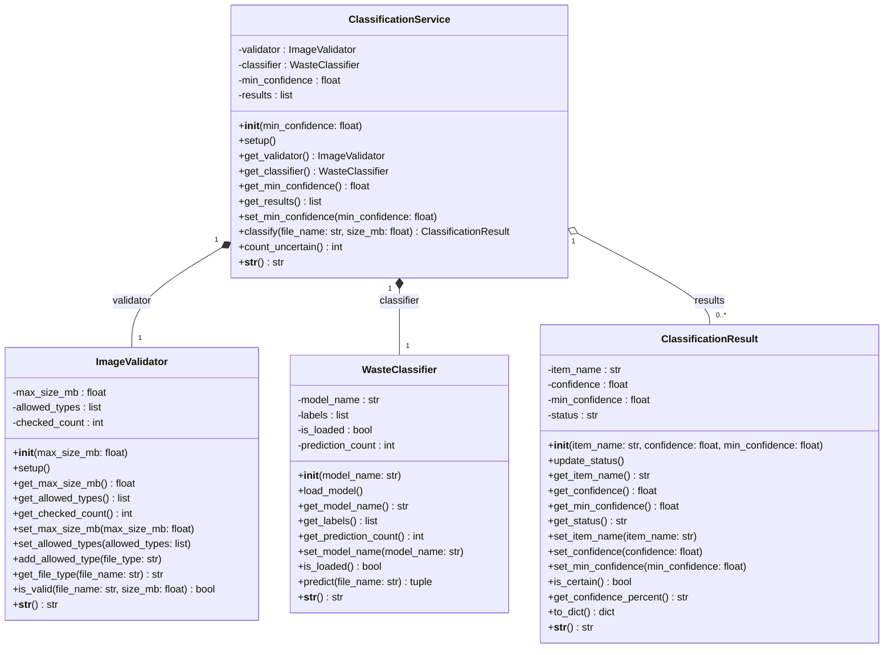
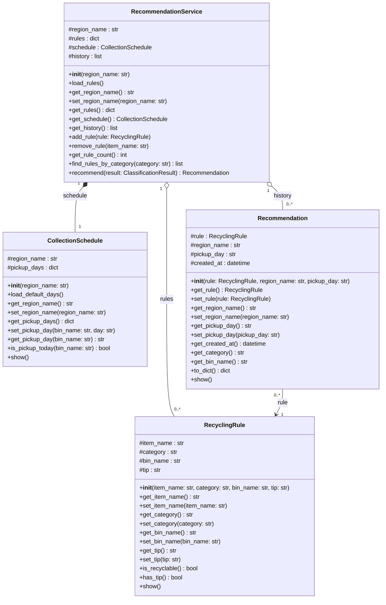
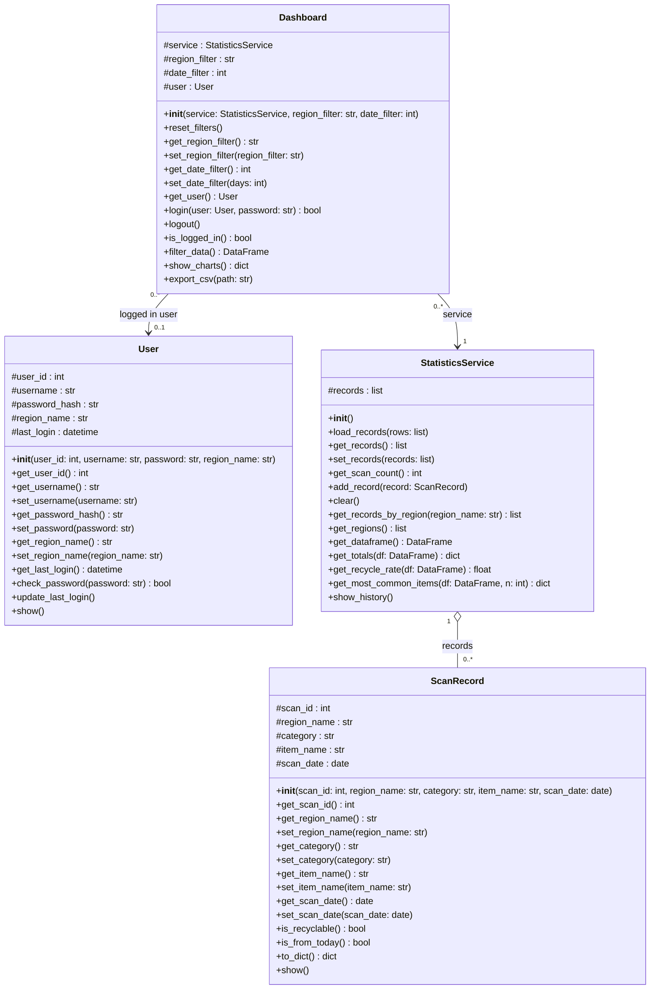
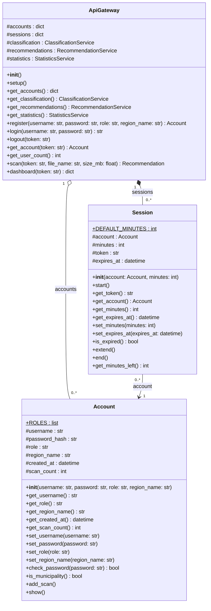

# AI-Powered Waste Sorting and Recycling Assistant

## Presentation Link

Video: https://drive.google.com/file/d/1GSH7Z3qS5UTvWmRkjlLXRY0kqqes1lxq/view?usp=sharing

Speaker: Ali Alagha

## Team Overview

| Member | Student ID | Subsystem |
|---|---|---|
| Amirhossein Owji | 7227410 | AI waste classification |
| Mahshid Jafari | 7227434 | Recycling recommendations |
| Ali Alagha | 7226045 | History and statistics, User interface and integration |

## How to Start

```bash
pip install -r requirements.txt
python main.py
```

## System Design

### AI waste classification (Amirhossein Owji)



### Recycling recommendations (Mahshid Jafari)



### History and statistics (Ali Alagha)



### User interface and integration (Ali Alagha)


