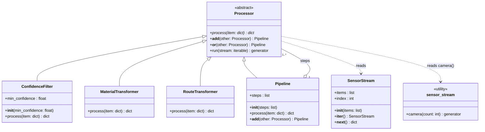

# AI-Powered Waste Sorting and Recycling Assistant

## Presentation Link

Video: _add link here_

## Team Overview

| Member | Student ID | Subsystem |
|---|---|---|
| Amirhossein Owji | 7227410 | AI waste classification |
| Mahshid Jafari | 7227434 | Recycling recommendations |
| Ali Alagha | 7226045 | History and statistics, User interface and integration |

## How to Start

Plain Python 3.11 or newer, no packages needed.

```bash
python -m stream_processing.main
```

## Class Diagram


